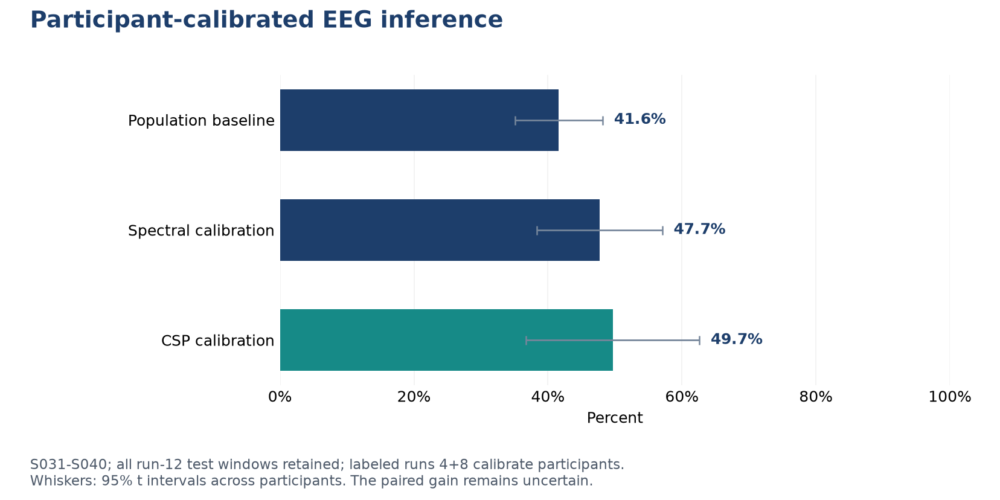

# Neuro Infer Service

**Project by Giacomo Albergo** | Independent portfolio project | October 2026

A research EEG inference service that treats input orientation, channel quality, sampling rate, model version and participant calibration as explicit engineering contracts.

**Technology:** Python, FastAPI, NumPy/SciPy, MNE-Python, CSP, scikit-learn

## What this demonstrates

- Built channel-major input validation, anti-aliased resampling, channel QC and a reusable spectral filter bank.
- Added an optional participant-specific two-band CSP/shrinkage-LDA decoder, with numeric model serialization and strict shape/version checks.
- Reserved S031-S040 for a fixed-protocol audit: calibration runs 4+8, test run 12, and all test windows retained.
- Exposed model scope and calibration identity; unknown or insufficiently calibrated participants use the population fallback. Calibration is opt-in.

## Evaluation

| Method on S031-S040 | Balanced accuracy, all test windows | 95% participant t interval |
| --- | ---: | ---: |
| Frozen population v2 | 41.6% | 35.1% to 48.2% |
| Spectral calibration | 47.7% | 38.3% to 57.1% |
| CSP calibration | 49.7% | 36.7% to 62.6% |

CSP's mean gain over the frozen population model is 8.0 percentage points, with a paired 95% interval from -6.2 to +22.3 points. The gain remains uncertain. Separately, exported numeric-model predictions and actual serving predictions matched exactly on all 300 held-out windows; API routing and unknown-participant fallback were also checked.

The [aggregate metrics](results/metrics.json) contain the values behind this figure. The findings describe the stated dataset, split and evaluation protocol.

## Scope and limitations

- Participant calibration requires labeled recordings from the same person; a calibration ID cannot be reused for another person.
- The mean accuracy gain is not conclusive, and participant variability is large.
- Signal-QC pass is not an accuracy guarantee, and softmax scores are uncalibrated.
- The project is a research prototype and does not support clinical or operational decisions.

## Portfolio access

This repository shares the project overview, methodology, aggregate results and figures. The implementation, training/inference code, model artifacts and full development history are maintained in a separate private repository. Access for a technical review can be discussed through [my GitHub profile](https://github.com/ZioJack99).

See [data and method sources](DATA_SOURCES.md) and [rights and attribution](RIGHTS.md). This is a portfolio showcase, not an open-source software release.
